<!-- Aarav Malik · GitHub profile -->

  

  

  
  
  
  

  

| | Project | What it does | Live |
|:-:|---|---|---|
| 01 | **StudyBull** | Free Hindi exam prep: 8,000+ MCQs, mock tests, current affairs, live Job Alert | [studybull.vercel.app](https://studybull.vercel.app) |
| 02 | **Padhai Path** | Video classes platform with fast streaming and instant skip | [pdhaipath.vercel.app](https://pdhaipath.vercel.app) |
| 03 | **Video Classes** | Video course site plus a Telegram link bot | [videoclasses.vercel.app](https://videoclasses.vercel.app) |
| 04 | **PadhLo** | A clean study companion for daily practice | [padhlo.sites.tab.bot](https://padhlo.sites.tab.bot) |
| 05 | **Karya AI** | An AI assistant demo that gets things done | [karya-ai-eight.vercel.app](https://karya-ai-eight.vercel.app) |
| 06 | **Files Bull** | Telegram bot that stores and shares study files | [Open on Telegram](https://t.me/filesbull_bot) |
| 07 | **Portfolio** | My portfolio, where arrows build the page live | [aarav-malik.vercel.app](https://aarav-malik.vercel.app) |

  
  

  

  

<b>सपने बड़े, इरादे फ़ौलादी।</b> © 2026 Aarav Malik · Made in India

